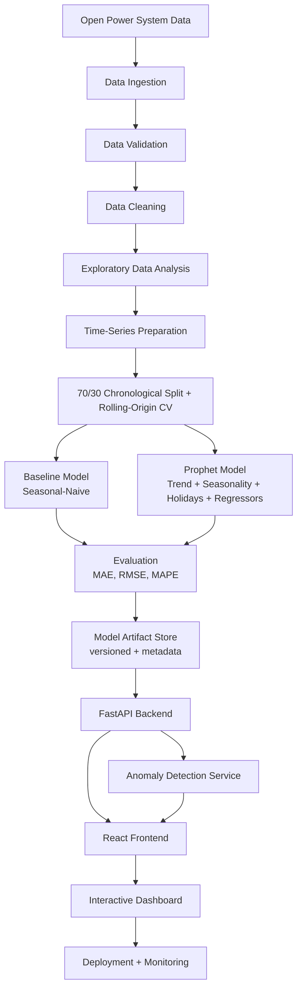
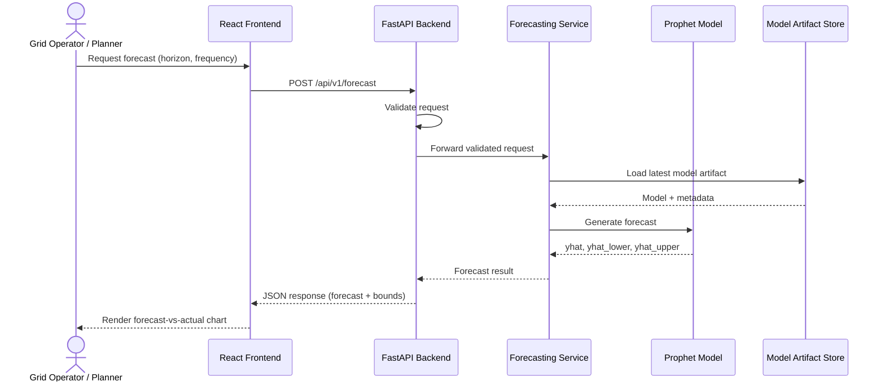
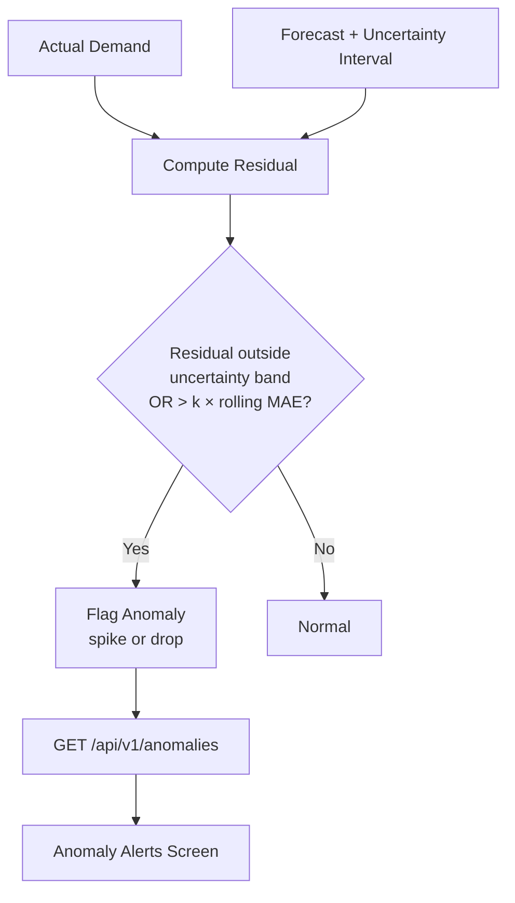
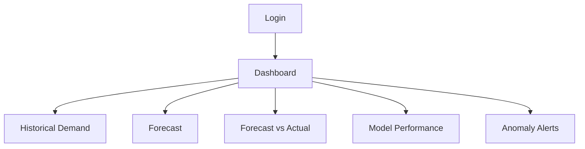
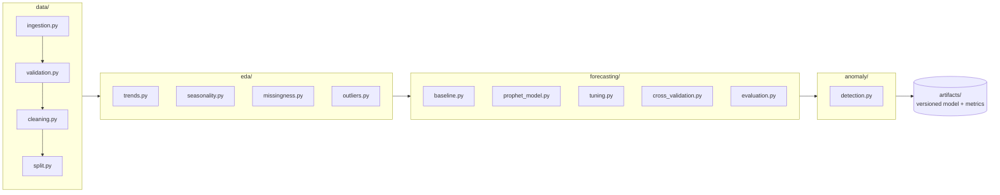
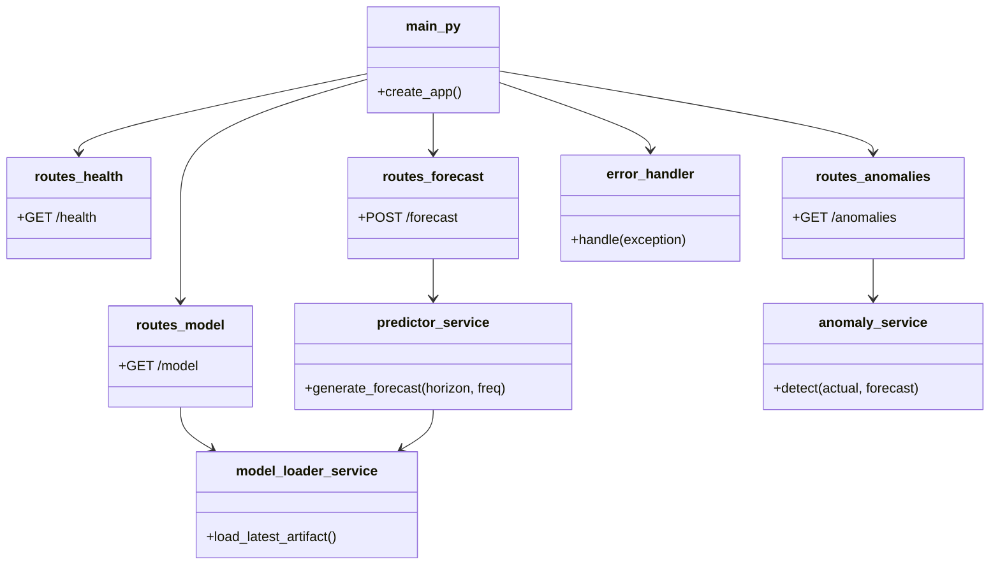
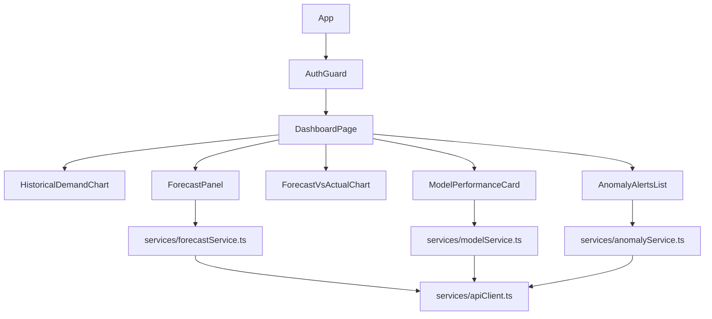
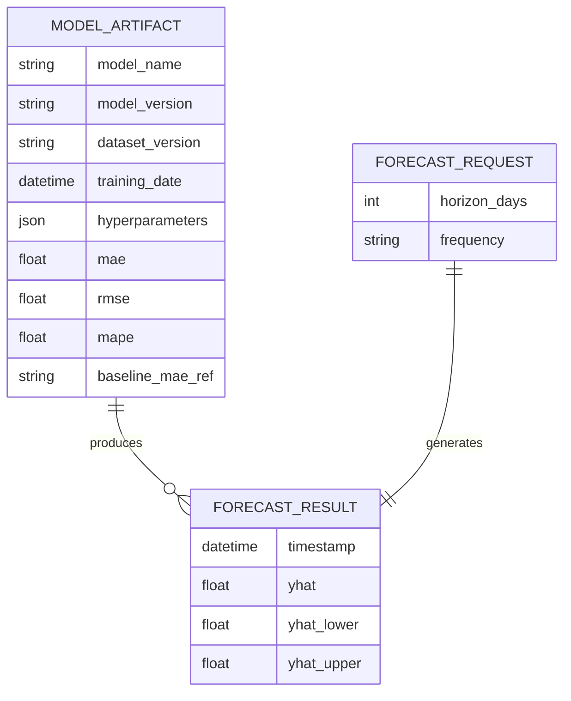

# Product Requirements Document
## Energy Demand Forecasting Tool

| | |
|---|---|
| **Version** | 2.1 (Revised) |
| **Track** | Advanced Data Science |
| **Domain** | Energy / Utilities |
| **Project Type** | Machine Learning + Full-Stack Web Application |
| **Primary Model** | Prophet (with naive baseline for comparison) |
| **Dataset** | Open Power System Data (OPSD) — Time Series |
| **Stack** | Python, FastAPI, React, Pandas, Prophet, Matplotlib, Tailwind CSS, Axios |
| **Primary Users** | Grid Operators, Energy Planners |
| **Reference** | Taylor & Letham, "Forecasting at Scale," PeerJ Preprints, 2017–2018 |

---

## 1. Executive Summary

The Energy Demand Forecasting Tool is a full-stack decision-support application that forecasts short-term (daily/weekly) electricity demand from historical OPSD time-series data, quantifies forecast accuracy, and flags anomalous demand behavior for grid operators and energy planners.

This is an end-to-end product, not a notebook-only ML exercise: **data → validation → EDA → modeling → evaluation → API → UI → deployment**, with model quality proven against a baseline rather than asserted.

---

## 2. Problem Statement

Grid operators and energy planners must anticipate electricity demand to manage supply, but:
- Raw historical data is hard to interpret manually at scale.
- Demand is driven by overlapping signals: daily/weekly cycles, seasonality, holidays, weather, and long-term growth trends.
- Naively extrapolating from history is unreliable and doesn't quantify its own error.
- There is no easy way to compare forecast vs. actual, measure accuracy, or get notified of abnormal demand.

This tool addresses all four gaps in a single application.

---

## 3. Goals & Measurable Success Criteria

| Goal | Metric | Target |
|---|---|---|
| Forecast beats naive baseline | % improvement in RMSE vs. seasonal-naive baseline | ≥ 15% |
| Forecast is usable for planning | MAPE on test set | < 10% (revisit once OPSD demand scale is known) |
| Anomalies are meaningfully rare | False-positive alert rate on test period | < 5% of days |
| System is responsive | P95 API latency for `/forecast` | < 2s for a 30-day horizon |
| System is reliable | Uptime during evaluation window | ≥ 99% |

> Targets are proposed defaults, to be recalibrated once EDA reveals the actual scale/volatility of OPSD demand — but every goal ships with a number, so "success" is falsifiable.

---

## 4. Target Users

### 4.1 Grid Operators
**Goal:** Monitor demand, catch abnormal patterns early.
**Needs:** fast-to-read dashboard, reliable alerts with low false-positive rate, forecast confidence bounds (not just a point estimate).

### 4.2 Energy Planners
**Goal:** Use trend and forecast data for medium-term planning.
**Needs:** exportable/reviewable trend breakdowns, accuracy metrics they can trust and explain to stakeholders.

---

## 5. Scope

### 5.1 In Scope (MVP)
- OPSD ingestion, validation, cleaning, EDA
- Baseline model (seasonal-naive) + Prophet model, benchmarked against each other
- Daily/weekly forecasting with holiday effects, trend-changepoint detection, and (recommended) weather as an exogenous regressor if a matching OPSD weather/load table is available
- Forecast uncertainty intervals (not just point forecasts)
- Rolling-origin backtesting in addition to the required 70/30 chronological split
- MAE + RMSE (+ MAPE) evaluation reported against baseline
- Residual-based anomaly detection with a documented default method
- FastAPI backend, React frontend, Axios integration
- Basic authentication/session handling
- Unit + integration tests, README, architecture docs, deployment

### 5.2 Out of Scope
- Automated grid control or generation adjustment
- Guaranteed accuracy claims or autonomous operational decisions
- Multi-region / multi-tenant support (single deployment, single dataset scope)
- Long-horizon (>90 day) forecasting

---

## 6. Data Requirements

### 6.1 Dataset
- Source: [OPSD time-series dataset](https://open-power-system-data.org/) — schema, granularity, and demand column(s) confirmed during EDA and documented in `/docs/data-dictionary.md` (never assumed in advance).
- License/attribution: OPSD is open data; attribution requirements captured in README per OPSD's license terms.

### 6.2 Validation Rules (finalize post-EDA, propose defaults)
- Timestamp monotonicity and uniform interval (flag/interpolate gaps)
- Duplicate timestamp detection
- Null/negative demand value checks
- DST transition handling (energy data commonly has a 23- or 25-hour day twice a year — must be handled explicitly, not silently dropped)

### 6.3 Exploratory Data Analysis
Trend, daily/weekly/seasonal patterns, missingness, outliers, and demand distribution, plus:
- Correlation check against any available temperature/weather series in OPSD, since this determines whether exogenous regressors are viable for Prophet.

---

## 7. Modeling Requirements

| Requirement | Detail |
|---|---|
| **Baseline model** | Seasonal-naive (e.g., demand = same hour/day last week) — mandatory, to prove Prophet earns its complexity |
| **Primary model** | Prophet, with: additive/multiplicative seasonality selection based on EDA, custom weekly/yearly seasonality terms, country-specific holiday calendar, changepoint detection for trend shifts |
| **Exogenous regressors** | Temperature (if available) added via `add_regressor` — stretch goal if data isn't available, not silently dropped |
| **Hyperparameter tuning** | Grid or Bayesian search over `changepoint_prior_scale` and `seasonality_prior_scale`, selected via cross-validation error, not defaults |
| **Validation methodology** | (a) Required 70/30 chronological split for the grading rubric, **and** (b) rolling-origin cross-validation (Prophet's `cross_validation`/`performance_metrics`) for a more robust accuracy estimate — report both |
| **Uncertainty intervals** | Expose `yhat_lower`/`yhat_upper` in the API and dashboard — critical for operator trust and risk-aware decisions |
| **Anomaly detection (default method)** | Flag a day as anomalous if actual demand falls outside the Prophet uncertainty interval by more than a configurable margin, OR the residual exceeds *k* × rolling MAE (k configurable, default k=3) |

---

## 8. Functional Requirements

### 8.1 Backend (FastAPI)
- `GET /api/v1/health` — service + model availability
- `POST /api/v1/forecast` — body: `{horizon_days, frequency}` → returns point forecast + uncertainty bounds
- `GET /api/v1/model` — model name/version, training date, dataset version, MAE/RMSE/MAPE (baseline vs. Prophet)
- `GET /api/v1/anomalies` — detected anomalies with date, actual, expected, deviation, method used
- Auth: JWT-based session tokens
- Standard error schema: `{status_code, error_type, message}` — no raw stack traces returned to clients
- Status codes: 400, 401/403, 422, 500, 503
- API versioned under `/api/v1` to allow non-breaking evolution

### 8.2 Frontend (React)
- Login → Dashboard → {Historical Demand, Forecast, Forecast vs Actual, Model Performance, Anomaly Alerts}
- All required states: loading, empty, success, validation error, API error, service unavailable
- Forecast-vs-actual chart shows uncertainty band, not just two lines
- Model Performance screen shows Prophet metrics **alongside baseline metrics** so improvement is visible

### 8.3 Non-Functional Requirements
- **Performance:** P95 latency < 2s for a 30-day forecast request
- **Scalability:** stateless forecasting service; model reloaded from artifact store, not retrained per request
- **Security:** JWT auth, HTTPS only, no PII beyond login credentials
- **Accessibility:** WCAG 2.1 AA — keyboard nav, semantic labels, alerts not conveyed by color alone
- **Observability:** structured logging of forecast requests, error rates, model-serving latency
- **Data governance:** OPSD license/attribution documented in README

---

## 9. High-Level Design (HLD)

### 9.1 System Overview

### 9.2 Request/Response Flow (Forecast Generation)

### 9.3 Anomaly Detection Flow

### 9.4 Information Architecture

---

## 10. Low-Level Design (LLD)

### 10.1 Training Pipeline Components

### 10.2 Backend Component Diagram

### 10.3 Frontend Component Diagram

### 10.4 Model Artifact Metadata (conceptual schema)

---

## 11. Testing Strategy

| Layer | Coverage target | Examples |
|---|---|---|
| Unit | ≥ 80% of data/forecasting modules | validation rules, MAE/RMSE calc, anomaly logic |
| Integration | Core API contracts | FastAPI + model service, FastAPI + data pipeline |
| End-to-end | Happy path + 2 failure paths | full request → forecast → dashboard render; model unavailable; invalid input |
| Regression | Model quality gate | fail CI if Prophet RMSE regresses > 10% vs. last committed baseline |

---

## 12. MLOps & Lifecycle

- **Model versioning:** artifact stored with dataset version, training date, hyperparameters, and evaluation metrics attached as metadata (exposed via `/api/v1/model`).
- **Retraining cadence:** manual retrain trigger for MVP; document expected cadence (e.g., monthly) as a future enhancement.
- **Drift monitoring:** log live prediction residuals; flag if rolling error exceeds training-time error by a set margin (future enhancement, not MVP-blocking).

---

## 13. Risks & Mitigations

| Risk | Impact | Mitigation |
|---|---|---|
| OPSD lacks weather/exogenous data | Caps forecast accuracy | Document as a known ceiling; pursue only if data available |
| Single train/test split gives misleading confidence | Overstated accuracy | Add rolling-origin CV as a required check, not optional |
| Anomaly thresholds untuned → alert fatigue | Operators ignore alerts | Start with residual/uncertainty-band method; validate false-positive rate on test set before ship |
| Scope creep from "nice to have" features | Missed deadline | MVP definition (Section 14) is hard-gated; enhancements deferred |

---

## 14. MVP Definition

Must prove, end-to-end: **Historical data → baseline + Prophet forecast → evaluation vs. baseline → FastAPI → React → dashboard with uncertainty bounds and anomaly alerts.**

---

## 15. Timeline & Milestones

Aligned to the project brief's three delivery phases:

```mermaid
gantt
    title Energy Demand Forecasting Tool — Delivery Phases
    dateFormat  X
    axisFormat %s
    section Phase 1 — Foundations
    Study Forecasting at Scale & Prophet fundamentals   :p1a, 0, 1
    Acquire & explore OPSD dataset                       :p1b, 0, 1
    Scaffold FastAPI backend + React shell               :p1c, 0, 1
    Build baseline model pipeline                        :p1d, 1, 1
    section Phase 2 — Core Model & API
    Train & tune full Prophet model                      :p2a, 1, 1
    Expose model via FastAPI endpoints                   :p2b, 1, 1
    Evaluate against MAE, RMSE (+ MAPE, CV)              :p2c, 2, 1
    Build React screens consuming the API                :p2d, 2, 1
    section Phase 3 — Integration & Delivery
    Frontend-backend integration                         :p3a, 3, 1
    UI/UX polish                                         :p3b, 3, 1
    Finalize evaluation against grading criteria         :p3c, 3, 1
    Deploy, document, demo, present                      :p3d, 4, 1
```

| Phase | Deliverables |
|---|---|
| **1 — Foundations** | Paper/Prophet study notes, FastAPI + React scaffolds, OPSD EDA, baseline (seasonal-naive) pipeline |
| **2 — Core Model & API** | Tuned Prophet model, `/forecast` `/model` endpoints, MAE/RMSE/MAPE evaluation, core React screens |
| **3 — Integration & Delivery** | End-to-end integration, anomaly alerts, polished dashboard, deployment, README + architecture docs, demo |

---

## 16. Definition of Done

- [ ] Baseline and Prophet models both trained and compared
- [ ] 70/30 split **and** rolling-origin CV results reported
- [ ] MAE, RMSE, MAPE reported for both models
- [ ] Uncertainty intervals exposed in API and UI
- [ ] Anomaly detection method documented and validated against false-positive rate target
- [ ] Unit + integration tests passing at target coverage
- [ ] API versioned, documented, structured error handling in place
- [ ] README with setup, data dictionary, architecture diagram, reproduction steps, and OPSD attribution
- [ ] Basic auth/user-session handling implemented
- [ ] Deployed and demoable end-to-end

---

## 17. Future Enhancements
- Additional models (SARIMA, XGBoost) for ensemble comparison
- Automated retraining + drift monitoring
- Forecast history/export, saved views, additional user roles
- Multi-region dataset support

---

## Appendix A — Explicit Assumptions (made falsifiable)
1. Dataset schema/fields confirmed only after EDA — no fields assumed in advance.
2. Forecast horizon options finalized after reviewing typical planning windows (propose 7/14/30-day options as default).
3. Anomaly threshold starts at the documented default in Section 7 and is tuned against the false-positive target in Section 3.
