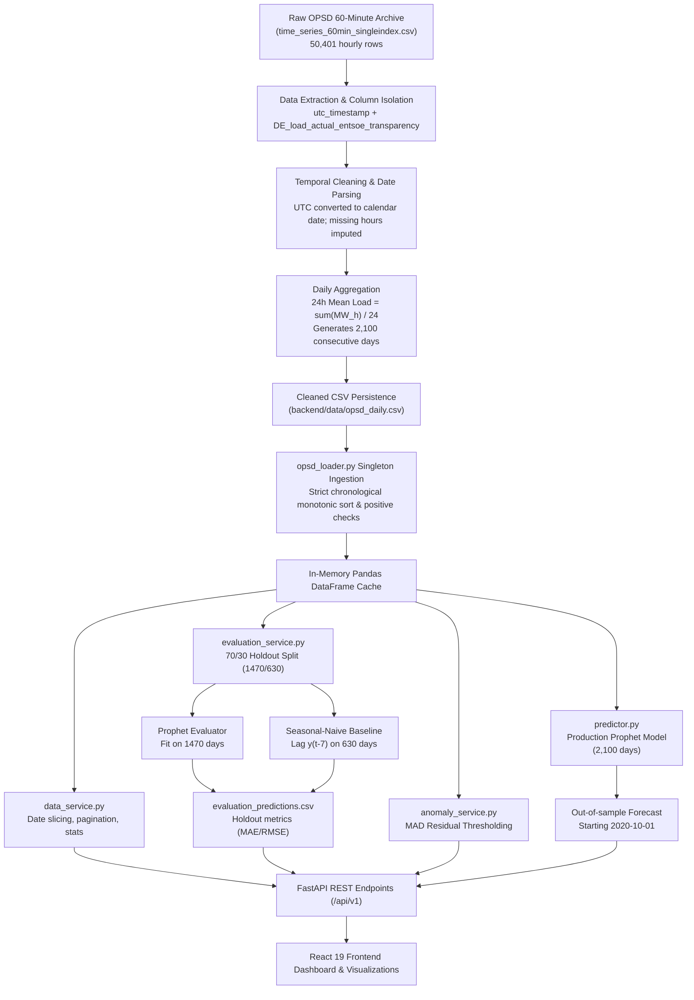

# 04. Dataset Specifications & Data Dictionary

This document specifies the exact dataset files, variables, data preprocessing pipelines, and data dictionary used across the **Energy Demand Forecasting Tool**.

---

## 1. Primary Dataset Specifications

```
┌────────────────────────────────┬────────────────────────────────────────────────────────┐
│ Dataset Property               │ Verified Value / Specification                         │
├────────────────────────────────┼────────────────────────────────────────────────────────┤
│ Official Dataset Name          │ Open Power System Data (OPSD) Time Series              │
│ Primary Originating Authority  │ European Network of Transmission System Operators      │
│                                │ for Electricity (ENTSO-E) Transparency Platform        │
│ Country / Geographic Boundary  │ Germany (DE) National Transmission Grid                │
│ Target Electrical Variable     │ DE_load_actual_entsoe_transparency                     │
│ Raw Archive File Path          │ data/raw/time_series_60min_singleindex.csv (130 MB)    │
│ Production Cleaned Daily File  │ backend/data/opsd_daily.csv (119 KB)                   │
│ Original Ingestion Resolution  │ 60-Minute Hourly Time Steps (50,401 raw observations)  │
│ Aggregated Modeling Resolution │ 24-Hour Calendar Day Mean Load (2,100 daily records)   │
│ Historical Horizon Start Date  │ 2015-01-01 (Thursday, New Year's Day)                  │
│ Historical Horizon End Date    │ 2020-09-30 (Wednesday)                                 │
│ Total Daily Observations       │ Exactly 2,100 Consecutive Days                         │
│ Missing Dates in Sequence      │ Zero (0) missing calendar dates                        │
│ Duplicate Dates in Sequence    │ Zero (0) duplicate calendar dates                      │
│ Missing Values in Target Col   │ Zero (0) null/NaN records in cleaned series            │
│ Target Demand Physical Unit    │ Megawatts (MW) — Electric Power                        │
│ Minimum Daily Load Observed    │ 38,952.67 MW (Recorded on 2016-09-18)                  │
│ Maximum Daily Load Observed    │ 68,183.58 MW (Recorded on 2019-01-23)                  │
│ Mean Historical Load Observed  │ 55,492.47 MW                                           │
│ Standard Deviation of Load     │ 6,599.90 MW                                            │
└────────────────────────────────┴────────────────────────────────────────────────────────┘
```

---

## 2. End-to-End Data Pipeline Flow



### Stage-by-Stage Explanation
1. **Raw Ingestion:** Ingests the 60-minute single-index CSV downloaded from the Open Power System Data portal containing multi-national European electrical variables.
2. **Column Extraction:** Isolates Germany's total grid load (`DE_load_actual_entsoe_transparency`) reported across the 50Hertz, Amprion, TenneT, and TransnetBW transmission zones.
3. **Daily Aggregation:** Averages the 24 hourly readings for each UTC calendar day into a single daily average power demand value in MW. This smooths intra-day volatility while preserving strong weekly and seasonal profiles.
4. **Validation & Monotonicity Verification:** [`opsd_loader.py`](file:///Users/dibbi/Desktop/OJT%20sem%205/Energy-Demand-Forecasting-Tool/backend/app/data/opsd_loader.py) verifies:
   - Date formats follow `%Y-%m-%d`.
   - Dates are strictly monotonically increasing ($t_{i+1} > t_i$).
   - Exactly zero duplicate dates exist.
   - All demand values are strictly positive ($y_t > 0$).
5. **In-Memory Singleton Caching:** Parsed observations are retained in Python memory as a DataFrame and a list of dictionary models, eliminating repeated file reads.

---

## 3. Comprehensive Data Dictionary

| Field Name | Data Type | Nature | Example Value | Where Used | Description |
| :--- | :--- | :--- | :--- | :--- | :--- |
| `date` / `ds` | String (`YYYY-MM-DD`) | Raw / Processed | `"2018-06-01"` | All Pages & APIs | The ISO-8601 calendar date of the observation or forecast. Mapped to `ds` for Prophet. |
| `demand` / `actual_demand` / `y` | Float | Raw Observation | `54291.68` | Dashboard, Historical, Comparison | Average electricity load in MW across Germany's transmission grid for the 24-hour day. Mapped to `y` for Prophet. |
| `trend` | Float | Decomposed Model Feature | `55840.12` | Historical, Model Info | The underlying non-periodic baseline growth/decline component extracted by Prophet. |
| `weekly_seasonality` | Float | Decomposed Model Feature | `3471.97` | Historical, Model Info | The 7-day cyclical offset in MW (positive on weekdays, negative on weekends). |
| `yearly_seasonality` | Float | Decomposed Model Feature | `-11531.57` | Historical, Model Info | The 365.25-day annual seasonal offset in MW (positive in winter, negative in summer). |
| `predicted_demand` / `forecasted_demand` / `yhat` | Float | Predicted Value | `54749.03` | Forecast, Comparison | The point prediction generated by the Prophet Generalized Additive Model. |
| `lower_bound` / `yhat_lower` | Float | Uncertainty Bound | `51516.68` | Forecast Page | 95% statistical lower uncertainty limit generated via empirical Markov Chain / MAP simulation. |
| `upper_bound` / `yhat_upper` | Float | Uncertainty Bound | `57981.38` | Forecast Page | 95% statistical upper uncertainty limit. |
| `weekly_total_mwh` | Float | Aggregated Calculation | `8622353.54` | Forecast Page | Total projected electrical energy in MWh for a 7-day weekly chunk: $\sum_{i=1}^7 \hat{y}_i \times 24.0\text{ h}$. |
| `baseline_predicted` | Float | Baseline Prediction | `56102.30` | Performance, Comparison | Demand predicted by the Seasonal-Naive benchmark ($y_{t-7}$, load from same weekday last week). |
| `residual` / `error` | Float | Statistical Calculation | `-2369.97` | Comparison, Anomalies | Difference between actual and predicted demand: $e_t = y_t - \hat{y}_t$. |
| `absolute_error` | Float | Statistical Calculation | `2369.97` | Comparison Page | Absolute magnitude of residual: $\|e_t\| = \|y_t - \hat{y}_t\|$. |
| `percentage_error` / `deviation_pct` | Float | Statistical Calculation | `-4.18` | Comparison, Anomalies | Signed percentage error: $((y_t - \hat{y}_t) / y_t) \times 100$. |
| `is_anomaly` | Boolean | Categorical Classification | `true` | Historical, Anomalies | Boolean flag set to `true` when $\|y_t - \hat{y}_t\| > \tau = 4,586.28\text{ MW}$. |
| `anomaly_type` | String | Categorical Classification | `"Drop"` | Anomalies Page | `"Spike"` if $y_t - \hat{y}_t > +\tau$; `"Drop"` if $y_t - \hat{y}_t < -\tau$. |
| `severity` | String | Categorical Classification | `"High"` | Anomalies Page | Severity grade: `"Low"` ($\tau$ to $1.167\tau$), `"Medium"` ($1.167\tau$ to $1.5\tau$), `"High"` ($> 1.5\tau$). |
| `mae` | Float | Evaluation Metric | `2624.10` | Dashboard, Performance | Mean Absolute Error in MW across the 630 held-out test days. |
| `rmse` | Float | Evaluation Metric | `3399.04` | Dashboard, Performance | Root Mean Squared Error in MW across the 630 held-out test days. |
| `mape` | Float | Evaluation Metric | `5.06` | Dashboard, Performance | Mean Absolute Percentage Error (%) across the 630 held-out test days. |

---

## 4. Strict Differentiation of Data Types

To ensure academic and technical rigor, this application strictly segregates and labels distinct data elements:

```
┌──────────────────────────────────────────────────────────────────────────────────┐
│                             Data Field Categorization                            │
├──────────────────────────┬───────────────────────┬───────────────────────────────┤
│ Concept                  │ Variable Notation     │ Operational Meaning           │
├──────────────────────────┼───────────────────────┼───────────────────────────────┤
│ Actual Historical Demand │ y(t)                  │ Real OPSD/ENTSO-E telemetry   │
│ Model In-Sample Fit      │ y_hat_train(t)        │ GAM curve on training data    │
│ Held-Out Prediction      │ y_hat_test(t)         │ Unseen holdout prediction     │
│ Baseline Prediction      │ y_hat_naive(t) = y(t-7│ Previous week's same weekday  │
│ Out-of-Sample Forecast   │ y_hat_future(t)       │ Post-2020 forward projection  │
│ Forecasting Residual     │ e(t) = y(t) - y_hat(t)│ Net prediction variance       │
│ Anomaly Flag             │ |e(t)| > 4,586.28 MW  │ Statistically anomalous day   │
└──────────────────────────┴───────────────────────┴───────────────────────────────┘
```
- **Actual Historical Demand ($y_t$):** Pure empirical measurements from transmission meters. Never modified, synthetic, or interpolated.
- **Model-Predicted Demand ($\hat{y}_t$):** In-sample or held-out test values calculated by summing Prophet's decomposed mathematical components: $\hat{y}_t = g(t) + s_w(t) + s_y(t) + h(t)$.
- **Forecasted Future Demand ($\hat{y}_{t > T}$):** Forward-looking projections extending past the historical dataset boundary ($t > 2020\text{-}09\text{-}30$). Accompanied by uncertainty intervals.
- **Baseline Predictions ($\hat{y}_t^{\text{naive}}$):** The Seasonal-Naive reference benchmark: Monday's load is predicted using the previous Monday's actual load ($y_{t-7}$).
- **Residuals ($e_t$):** The raw mathematical discrepancy $y_t - \hat{y}_t$. Positive values denote under-prediction; negative values denote over-prediction.
