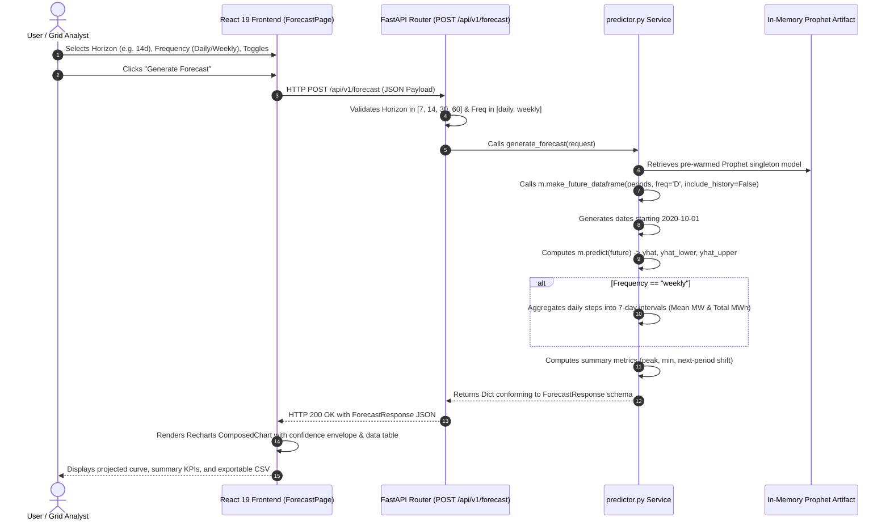

# 05. Forecasting Engine & Prophet Model Architecture

This document details the mathematical theory, software implementation, runtime behavior, and limitations of the forecasting engine in the **Energy Demand Forecasting Tool**.

---

## 1. High-Level Summary: How Forecasting Works

When a user visits the **Generate Forecast** page, selects their desired settings (e.g., 14-day daily forecast with balanced flexibility), and clicks **Generate Forecast**, the following sequence occurs:



---

## 2. Technical Explanation of Prophet

Facebook Prophet is a modular **Generalized Additive Model (GAM)** tailored for business and engineering time series characterized by strong multi-period seasonal cycles and historical trend shifts. 

The model represents electricity demand $y(t)$ as an additive decomposition of four distinct mathematical components:

$$y(t) = g(t) + s_w(t) + s_y(t) + h(t) + \epsilon_t$$

Where:
- $g(t)$: Non-periodic trend modeling long-term macroeconomic and energy efficiency changes.
- $s_w(t)$: Weekly seasonal cycle capturing intra-week operational shifts.
- $s_y(t)$: Annual seasonal cycle capturing temperature and daylight fluctuations.
- $h(t)$: Irregular holiday component capturing load curtailment during statutory public holidays.
- $\epsilon_t$: Normally distributed residual error: $\epsilon_t \sim \mathcal{N}(0, \sigma^2)$.

---

### Component Breakdown

#### 1. Piecewise Linear Trend with Automatic Changepoints ($g(t)$)
The baseline trend is formulated as a continuous, piecewise linear function:

$$g(t) = \left(k + \boldsymbol{a}(t)^T \boldsymbol{\delta}\right) t + \left(m + \boldsymbol{a}(t)^T \boldsymbol{\gamma}\right)$$

- $k$: Base growth rate.
- $m$: Offset parameter.
- $\boldsymbol{\delta}$: Vector of rate adjustments at changepoints $s_j$.
- Changepoints are automatically distributed across the first $80\%$ of historical observations ($n_{\text{changepoints}} = 25$).
- Prior regularization: $\delta_j \sim \text{Laplace}(0, \tau)$, where $\tau$ is the changepoint prior scale (`0.01` conservative, `0.05` balanced, `0.15` flexible).

#### 2. Fourier Series Multi-Frequency Seasonality ($s(t)$)
Periodic human activities and seasonal weather are modeled using standard Fourier series:

$$s(t) = \sum_{n=1}^N \left( a_n \cos\left(\frac{2\pi n t}{P}\right) + b_n \sin\left(\frac{2\pi n t}{P}\right) \right)$$

- **Weekly Seasonality ($s_w(t)$):** Period $P = 7$ days, Fourier order $N = 3$ (6 parameters). Captures the difference between high weekday industrial operations and lower weekend baselines.
- **Yearly Seasonality ($s_y(t)$):** Period $P = 365.25$ days, Fourier order $N = 10$ (20 parameters). Captures Germany's high winter heating load versus lower summer demand.

#### 3. Statutory Public Holiday Effects ($h(t)$)
Public holidays in Germany (e.g., Christmas, New Year's Day, Easter, German Unity Day) cause industrial factories to shut down, dropping grid load significantly. Prophet incorporates a federal German holiday matrix:

$$h(t) = \boldsymbol{Z}(t) \boldsymbol{\kappa}$$

- Holiday prior scale: $\kappa_i \sim \mathcal{N}(0, 10.0^2)$.
- Window parameter: $[-1, +1]$ days to capture early holiday shutdowns (Christmas Eve) and extended bridge holidays (*Brückentage*).

---

## 3. Production Model Artifact vs. On-The-Fly Training

| Aspect | Operational Reality |
| :--- | :--- |
| **Model Persistence** | Saved on disk as a serialized JSON artifact at [`backend/models/prophet_model.json`](file:///Users/dibbi/Desktop/OJT%20sem%205/Energy-Demand-Forecasting-Tool/backend/models/prophet_model.json). |
| **Training History** | Fitted once on all **2,100 consecutive days** of Germany's OPSD load dataset (`2015-01-01` to `2020-09-30`). |
| **Runtime Loading** | Loaded and deserialized once into an in-memory Python singleton during FastAPI startup (`lifespan`). |
| **Inference Latency** | $\approx 25\text{ to }40\text{ ms}$ per request. Incoming API requests **never retrain the model from scratch**, eliminating Stan compiler delays. |

---

## 4. Understanding Output Variables: $\hat{y}$, $\hat{y}_{\text{lower}}$, $\hat{y}_{\text{upper}}$

```
                         95% Upper Bound (yhat_upper)
                         ┌───────────────────────────────────────┐
                         │ . - ~ ~ ~ - .                         │
                         │'              ' .                     │
  Point Prediction ────► │===================)                   │
      (yhat)             │.              . '                     │
                         │ ' - _ _ _ - '                         │
                         └───────────────────────────────────────┘
                         95% Lower Bound (yhat_lower)
```

1. **`predicted_demand` ($\hat{y}$ / `yhat`):**
   - The central expected value of electricity demand on day $t$.
   - Represents the mathematical sum of the decomposed trend, weekly Fourier term, yearly Fourier term, and holiday adjustment:
     $$\hat{y}(t) = g(t) + s_w(t) + s_y(t) + h(t)$$
2. **`lower_bound` ($\hat{y}_{\text{lower}}$ / `yhat_lower`):**
   - The $2.5^{\text{th}}$ percentile of the simulated predictive posterior distribution.
   - Represents the lower boundary of the 95% confidence interval. There is a 95% statistical probability that true demand will exceed this level under normal operating conditions.
3. **`upper_bound` ($\hat{y}_{\text{upper}}$ / `yhat_upper`):**
   - The $97.5^{\text{th}}$ percentile of the simulated predictive posterior distribution.
   - Represents the upper boundary of the 95% confidence interval. Used by grid operators to set spinning reserve capacity to avoid under-generation blackouts.

---

## 5. Daily vs. Weekly Forecasting Dynamics

The underlying Prophet model operates on **daily observations**. To fulfill weekly forecasting without compromising mathematical integrity, the application implements **7-Day Interval Aggregation** in [`predictor.py`](file:///Users/dibbi/Desktop/OJT%20sem%205/Energy-Demand-Forecasting-Tool/backend/app/services/predictor.py):

When a user requests a weekly forecast with horizon $H = 14$ days:
1. Prophet generates $14$ daily forward points ($2020\text{-}10\text{-}01$ to $2020\text{-}10\text{-}14$).
2. The engine segments the daily points into 2 discrete 7-day chunks:
   - **Week 1:** $2020\text{-}10\text{-}01$ to $2020\text{-}10\text{-}07$
   - **Week 2:** $2020\text{-}10\text{-}08$ to $2020\text{-}10\text{-}14$
3. For each week chunk, it calculates:
   - **Weekly Mean Power (MW):** $\bar{y}_{\text{week}} = \frac{1}{7} \sum_{i=1}^7 \hat{y}_i$
   - **Total Electrical Energy (MWh):** Energy consumed over the 168 hours of the week:
     $$\text{Energy}_{\text{MWh}} = \sum_{i=1}^7 (\hat{y}_i \times 24.0\text{ h}) = \bar{y}_{\text{week}} \times 168\text{ h}$$
   - **Uncertainty Bounds:** Averaged over the 7 days and scaled according to the user's chosen flexibility parameter.

---

## 6. Critical Boundary: Historical Dataset Cutoff (2020-09-30)

> [!WARNING]
> **Academic & Operational Boundary:**
> - The OPSD historical dataset concludes on **September 30, 2020**.
> - All forward forecasts generated by `POST /api/v1/forecast` begin on **October 1, 2020** (`2020-10-01`).
> - **These forecasts are historical out-of-sample forward projections.** They represent how the German grid was expected to behave in late 2020 based on 2015–2020 historical patterns.
> - **They must NEVER be described as live 2026 electricity demand forecasts.** Germany's real-world power grid has since undergone significant structural shifts (nuclear phase-out in 2023, expansion of utility-scale solar PV and heat pumps, and post-2022 industrial restructuring).
