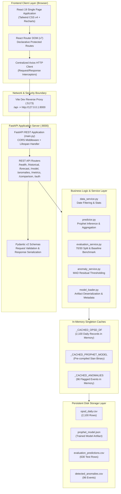
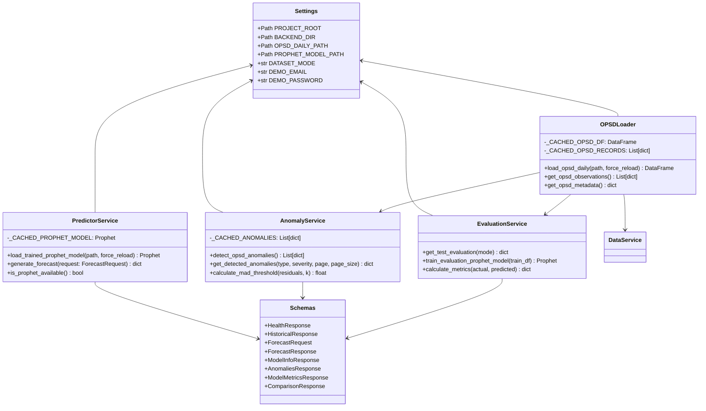
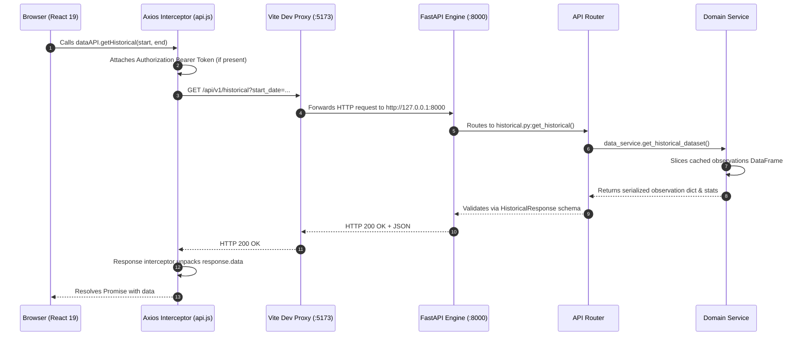
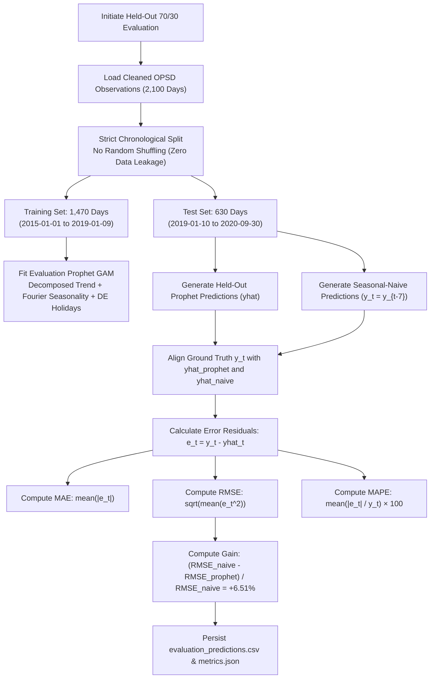

# 08. System Architecture: High-Level & Low-Level Design (HLD & LLD)

This document details the architectural blueprints of the **Energy Demand Forecasting Tool**, documenting the relationship between the React frontend, FastAPI backend, in-memory caching layers, and persistent storage artifacts.

---

## 1. High-Level Design (HLD) Diagram

The system follows a decoupled Client-Server architecture. The React SPA communicates with the asynchronous FastAPI backend exclusively via JSON-over-HTTP REST APIs:



---

## 2. Low-Level Design (LLD) Diagram

The LLD illustrates internal class hierarchies, Pydantic data contracts, and Python module interactions:



---

## 3. Frontend-to-Backend Request Flow



---

## 4. Detailed Data Processing Flow

```mermaid
flowchart LR
    A["Raw ENTSO-E 60-min Archive<br/>50,401 Rows"] -->|Hourly Mean<br/>Pandas Resample| B["Daily OPSD CSV<br/>2,100 Rows"]
    B -->|FastAPI Lifespan Startup| C["opsd_loader.py Validation"]
    C -->|Check Monotonicity<br/>No Duplicates, Demand > 0| D["In-Memory DataFrame Cache"]
    D -->|Slice: 2015-01-01 to 2019-01-09| E["70% Train Partition<br/>(1,470 Days)"]
    D -->|Slice: 2019-01-10 to 2020-09-30| F["30% Test Partition<br/>(630 Days)"]
    E -->|Prophet Fit| G["Evaluation Prophet Model"]
    F -->|Inference| H["Test Predictions (yhat)"]
    F -->|Lag y(t-7)| I["Seasonal-Naive Baseline"]
    H & I -->|Compute Residuals| J["Metrics Engine<br/>MAE, RMSE, MAPE"]
    E -->|Training Residuals| K["MAD Formulation<br/>τ = 4,586.28 MW"]
    K & D -->|Scan 2,100 Days| L["Anomaly Registry<br/>(96 Events)"]
```

---

## 5. Forecast Generation Flow

```mermaid
flowchart TD
    Req["Incoming ForecastRequest<br/>(Frequency, Horizon, Changepoint, Seasonality)"] --> Val{"Validation Checks"}
    Val -->|Horizon not in [7,14,30,60]| Err1["HTTP 400 Bad Request<br/>Invalid Horizon"]
    Val -->|Frequency not in [daily, weekly]| Err2["HTTP 400 Bad Request<br/>Invalid Frequency"]
    Val -->|Valid Parameters| Cache["Retrieve Cached Prophet Model Artifact"]
    Cache --> Frame["make_future_dataframe(periods=H, freq='D', include_history=False)"]
    Frame --> Cutoff["Generate Dates starting 2020-10-01<br/>(Post-Historical Extrapolation)"]
    Cutoff --> Infer["model.predict(future)<br/>Compute yhat, yhat_lower, yhat_upper"]
    Infer --> Scale["Apply Changepoint Flexibility Multiplier<br/>(Conservative: 0.85, Balanced: 1.0, Flexible: 1.25)"]
    Scale --> ModeCheck{"Frequency Mode?"}
    ModeCheck -->|Daily| DailyRes["Format Daily ForecastPoint Objects"]
    ModeCheck -->|Weekly| WeekAgg["Segment into 7-Day Calendar Intervals<br/>Mean MW = sum(yhat)/7<br/>Total Energy MWh = Mean MW × 168h"]
    DailyRes & WeekAgg --> Summary["Calculate Peak, Base, and % Shift vs Latest Actual"]
    Summary --> Resp["Return ForecastResponse JSON Object"]
```

---

## 6. Model Evaluation Flow



---

## 7. Anomaly Detection Flow

```mermaid
flowchart TD
    ScanInit["Initiate Anomaly Detection Pipeline"] --> TrRes["Extract 1,470 Training Residuals (e_train)"]
    TrRes --> Med["Calculate Median Residual (M = 255.03 MW)"]
    Med --> MAD["Calculate MAD: median(|e_train - M|) = 1,031.14 MW"]
    MAD --> Sigma["Calculate Normal Consistency: σ_MAD = 1.4826 × MAD = 1,528.76 MW"]
    Sigma --> Thresh["Establish Threshold: τ = 3.0 × σ_MAD = 4,586.28 MW"]
    Thresh --> Loop["Iterate Over All 2,100 Days (t = 1 to 2,100)"]
    Loop --> Diff["Calculate Daily Residual: e_t = y_t - yhat_t"]
    Diff --> Check{"|e_t| > 4,586.28 MW?"}
    Check -->|No| Normal["Mark as Normal Observation (2,004 Days)"]
    Check -->|Yes| Flag["Flag as Anomaly Event (96 Days)"]
    Flag --> TypeCheck{"e_t > 0?"}
    TypeCheck -->|Yes| Spike["Classify as Spike (19 Events)"]
    TypeCheck -->|No| Drop["Classify as Drop (77 Events)"]
    Spike & Drop --> SevCheck{"Assign Severity Tier"}
    SevCheck -->|4,586 < |e| ≤ 5,350 MW| Low["Low Severity (21 Events)"]
    SevCheck -->|5,350 < |e| ≤ 6,879 MW| Med["Medium Severity (14 Events)"]
    SevCheck -->|> 6,879 MW| High["High Severity (61 Events)"]
    Low & Med & High --> JSON["Serialize detected_anomalies.csv & .json"]
```
